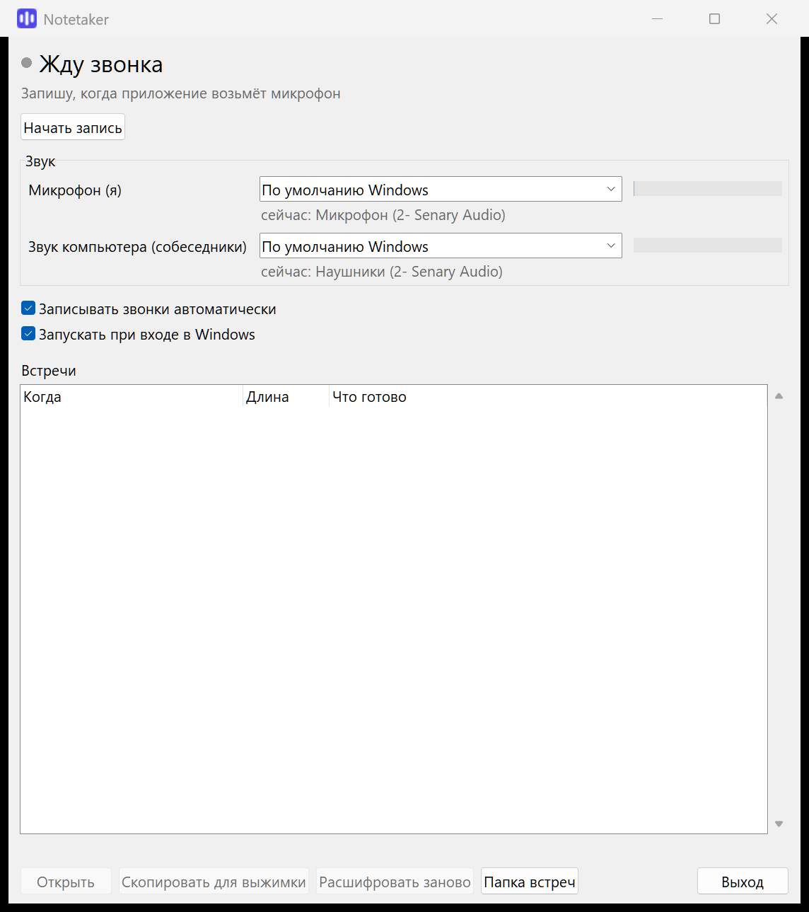

# Notetaker

Записывает звонки и встречи на компьютере с Windows и расшифровывает их на русском. Всё работает прямо на компьютере, без интернета: запись и текст никуда не отправляются.



## Что умеет

- **Сам замечает звонок.** Teams, Zoom, Телемост, Skype, звонок в браузере — когда любое приложение берёт микрофон, Notetaker начинает запись. Звонок закончился — останавливается сам. Голосовое в мессенджере или диктовка короче минуты встречей не считаются: такая запись удаляется без следа и без уведомлений.
- **Пишет обе стороны:** ваш микрофон и звук собеседников из динамиков или наушников.
- **Расшифровывает на компьютере** моделью GigaAM v3 (русский язык). Час разговора — несколько минут работы.
- **Различает голоса:** «Я», «Собеседник 1», «Собеседник 2»… Работает и в переговорке, где все говорят в один ноутбук: там будет «Я», «В комнате 1», «В комнате 2».
- **Выжимка — в один клик:** кнопка «Скопировать для выжимки» кладёт в буфер обмена расшифровку и готовый запрос. Вставьте его в любой чат с нейросетью (ChatGPT, GigaChat, Claude…) и получите главное, задачи по исполнителям и открытые вопросы.
- Шкалы уровня звука, выбор микрофона и динамиков — можно переключить прямо посреди записи.
- Встречу в переговорке без звонка можно записать кнопкой «Начать запись».

## Установка

Скачайте последнюю версию на странице [Releases](https://github.com/Stanislavv8/notetaker/releases/latest):

- **`Notetaker-<версия>-setup.exe`** — установщик. Права администратора не нужны, ставится в ваш профиль, делает ярлыки и по желанию автозапуск.
- **`Notetaker-<версия>-portable.zip`** — без установки: распакуйте в любую папку и запустите `Notetaker.exe`. Настройки и встречи хранятся в той же папке.

При первом запуске Windows может показать «Windows защитил ваш компьютер»: программа не подписана сертификатом. Нажмите «Подробнее» → «Выполнить в любом случае».

**Требования:** Windows 10 или 11, 64 бит; около 1 ГБ свободной памяти во время расшифровки; 500 МБ на диске плюс место под записи (час встречи — около 30 МБ).

## Как пользоваться

1. Запустите Notetaker — значок появится в трее, рядом с часами. Крестик окна только прячет его, программа продолжает работать. Совсем закрыть — «Выход».
2. Начался звонок — Notetaker пишет его, значок в трее красный. Когда запись идёт дольше минуты, придёт уведомление «Пишу встречу». Не нужно — щёлкните по значку в трее или нажмите «Не записывать».
3. Звонок закончился — Notetaker сожмёт запись и расшифрует её, ход виден в списке встреч. Когда готово, придёт уведомление.
4. Выберите встречу в списке: «Открыть» — расшифровка, «Скопировать для выжимки» — расшифровка с запросом для нейросети.

Если расшифровка прервалась (выключили компьютер, закрыли программу), она продолжится при следующем запуске. Если что-то пошло не так — выберите встречу и нажмите «Расшифровать заново».

## Где лежат файлы

| Что | Установленная версия | Портативная версия |
| --- | --- | --- |
| Встречи: `встреча.ogg` и `расшифровка.md` | `Документы\Notetaker\<дата время>\` | `meetings\` рядом с программой |
| Настройки, журнал, отпечаток вашего голоса | `%LOCALAPPDATA%\Notetaker\` | `data\` рядом с программой |

## Важно

Предупреждайте собеседников о записи. Правила записи разговоров зависят от страны и компании — проверьте их у себя.

Метки голосов ставятся автоматически и на перебивках могут ошибаться, а в именах и терминах бывают ошибки распознавания. Notetaker узнаёт ваш голос со временем, по встречам, где в микрофон говорили только вы.

## Сборка из исходников

```bash
python -m venv .venv
.venv\Scripts\pip install -r requirements-build.txt
.venv\Scripts\python scripts\fetch_models.py
.venv\Scripts\python tests\acceptance.py
.venv\Scripts\python scripts\build.py
```

`build.py` собирает `dist\Notetaker-<версия>-portable.zip` и, если установлен [Inno Setup 6](https://jrsoftware.org/isinfo.php), установщик. Новая версия: поменять `__version__` в `notetaker/app.py`, поставить тег `v<версия>` и отправить его на GitHub — релиз соберётся сам (`.github/workflows/release.yml`).

Приёмка (`tests/acceptance.py`) пишет звук с настоящих устройств и имитирует звонки, поэтому запускается на компьютере, а не в облаке.

## Лицензия

MIT — см. [LICENSE](LICENSE). Модели и библиотеки внутри сборки — см. [THIRD-PARTY-NOTICES.md](THIRD-PARTY-NOTICES.md).
